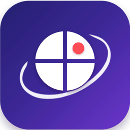
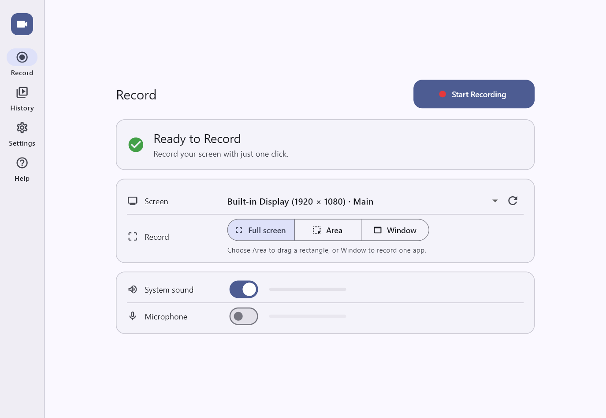
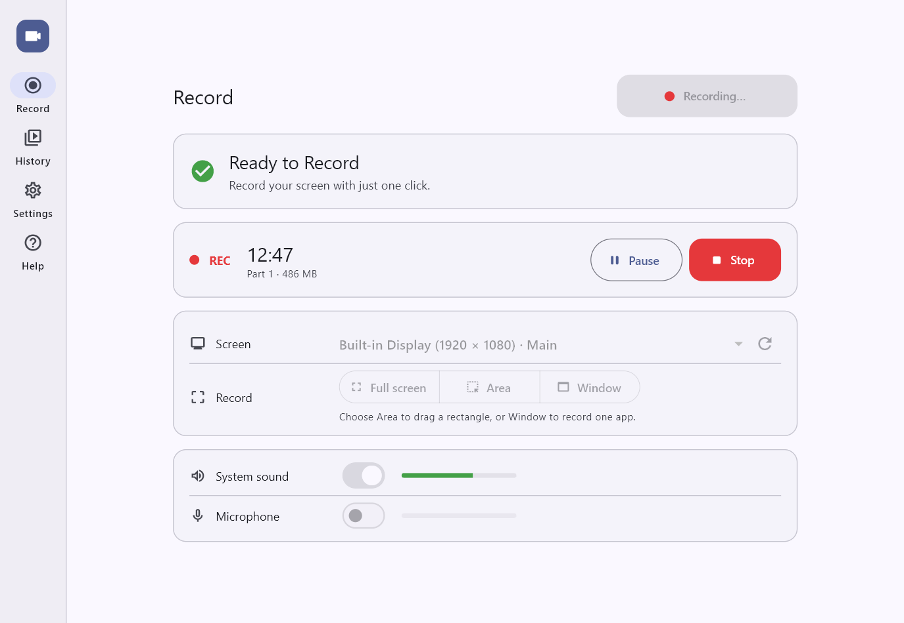
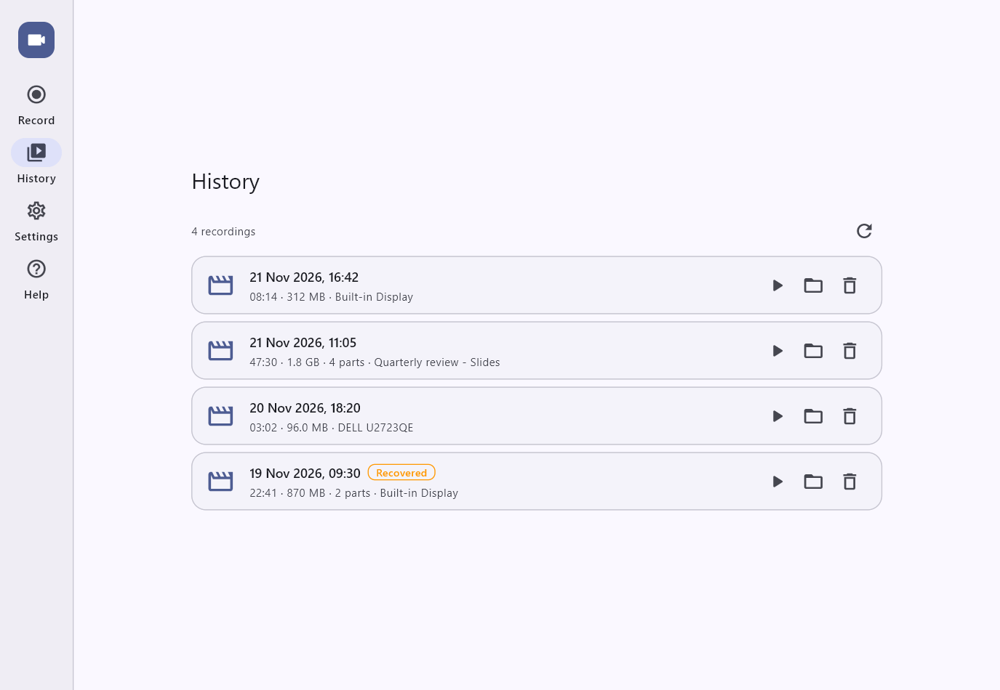
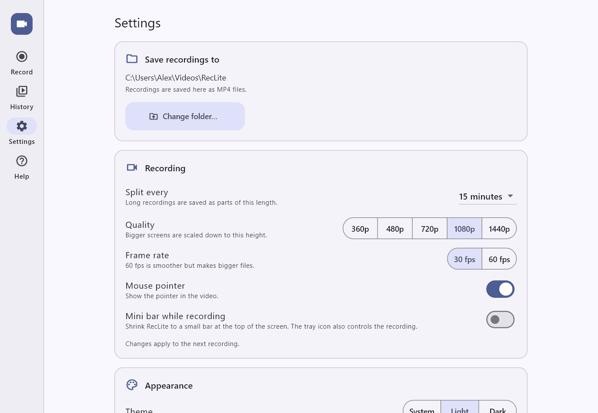
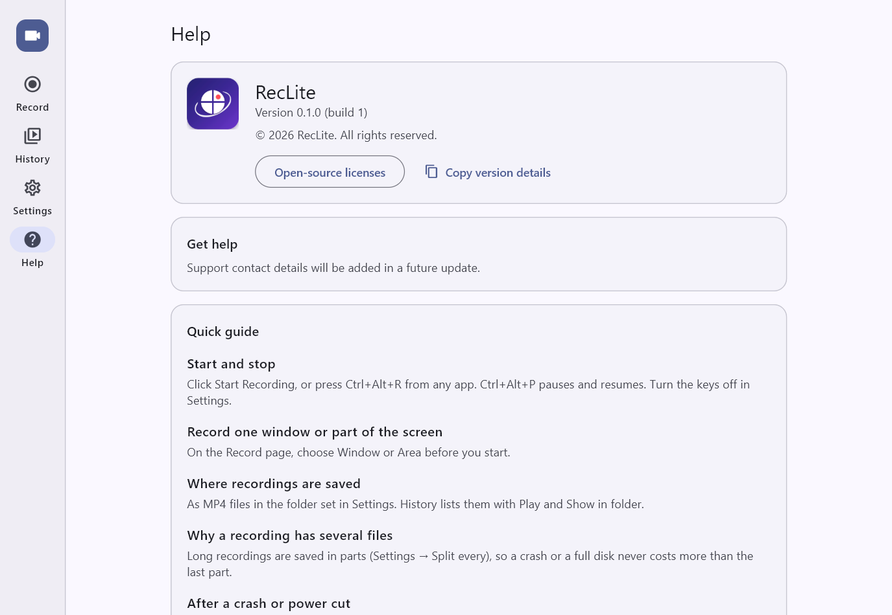

  

<h1 align="center">RecLite</h1>

A lightweight screen recorder for Windows and macOS.

  

## Features

- Record the full screen, a selected area, or a single app window
- System sound and microphone, mixed into one audio track
- Pause and resume at any time
- Long recordings are saved in parts, so a crash never costs more than the last few minutes
- Recordings are repaired automatically after a crash or power cut
- History of past recordings: play, show in folder, move to Recycle Bin
- Quality from 360p to 1440p, 30 or 60 fps, mouse pointer on or off
- Keyboard shortcuts that work from any app, a mini recording bar and a tray icon
- Light and dark theme
- Private by design: nothing leaves your computer

## Screenshots

| Recording | History |
|---|---|
|  |  |
| **Settings** | **Help** |
|  |  |

## Download

| Platform | Installer | Requires |
|---|---|---|
| Windows | `RecLite-0.1.0-windows-x64-setup.exe` from [Releases](https://github.com/manishsubah/sc_recod_dk/releases) | Windows 10 (version 2004) or later |
| macOS | Coming soon | macOS 13 or later |

## Built with

Flutter for the interface, with native recording engines written in C++ for
Windows (Windows Graphics Capture, Media Foundation, WASAPI) and Swift for
macOS (ScreenCaptureKit, AVFoundation). Videos are saved as standard MP4 files
(H.264 video, AAC audio) using hardware encoding.

## Copyright

© 2026 RecLite. All rights reserved.
Designed and developed by Manish Ranjan.

Use of RecLite is subject to its [End User License Agreement](installers/LICENSE.txt).
